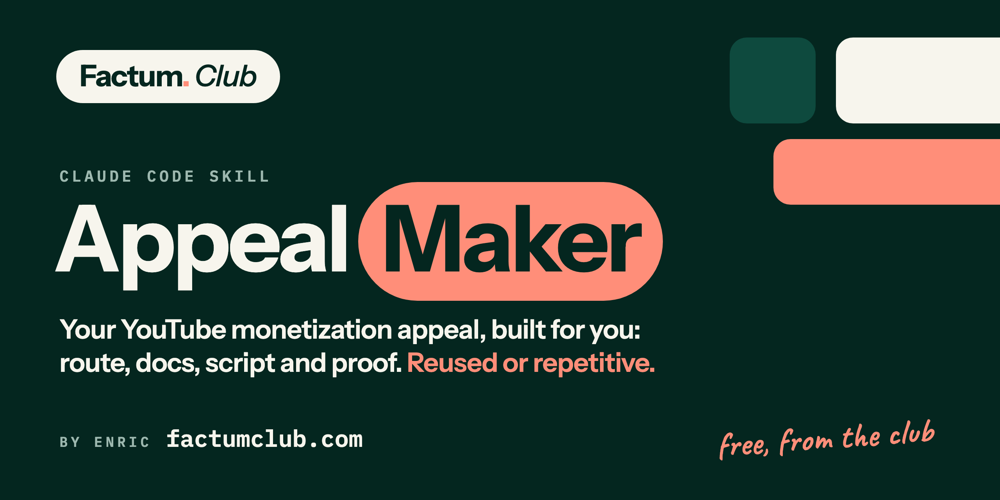

<p align="center"></p>

# Appeal Maker

**A Claude Code skill for YouTube monetization appeals.** Made by Enric
([@enricpedro](https://x.com/enricpedro)) and shared free by
**[Factum Club](https://factumclub.com)**.

Your channel was rejected, suspended or demonetized for **reused content** or for **generic /
repetitive (inauthentic) content**? This skill makes Claude:

- **pick the right route** with you: appeal now (Option 1) or edit the channel and reapply after 90
  days (Option 2), with YouTube's official rules and honest odds, and protect your other channels
  while the suspension lasts
- build the **appeal video script** (under 5 minutes), with the exact screen to show at every moment
- build a **Google Drive folder** of reviewer-ready docs: channel bible, production rules, one doc per
  episode, a side-by-side comparison (reused) or a 10-episode range grid plus your variety rules
  (generic / repetitive), and an **annotated script** that shows every image and on-screen card on
  the line where it appears
- prepare the **media** you show on screen: voiceover MP3, frames, cards, a **layers demo** of your
  edit, a chapters-and-facts cut
- suggest **new titles and thumbnail briefs** for your videos when your rejection is generic /
  repetitive (one title formula and one thumbnail layout are the most reported trigger), and leave them
  alone when it is reused content, where they are not the issue
- write the **title and description** for the unlisted appeal video

**What to expect.** For **reused content** the method is proven: 3 appeals, 3 channels monetized. For
**generic or repetitive content** appeals rarely win for story and narration channels (ours lost, and
no public win was found in about 12 cases): the realistic route there is a varied catalogue and a
reapply after 90 days, and the skill tells you so and helps with both. A failed appeal costs you no
reapply time.

It works with any niche and any production method: video editor, AI video tool, human editor or your
own automation. It never asks you to tell YouTube anything untrue.


---

## What you need

| Need | Why | How |
|---|---|---|
| **Claude Code** (paid Claude plan) | runs the skill on your computer, where your files are | [claude.com/claude-code](https://claude.com/claude-code) |
| **Python 3** | runs the two helper scripts (no extra packages) | Mac: run `xcode-select --install` if `python3` is missing · Windows: [python.org](https://www.python.org/downloads/) |
| **ffmpeg** | finds the cuts in your video, pulls frames, makes the MP3 | Mac: `brew install ffmpeg` · Windows: `winget install Gyan.FFmpeg` |
| **Google Drive connector** (recommended) | Claude creates the docs folder for you | claude.ai > Settings > Connectors > Google Drive. Without it, Claude writes HTML files and you upload them to Drive (they become Google Docs) |
| **yt-dlp** | reads your channel's public video list (titles, views) from YouTube, no account or API key needed | Mac: `brew install yt-dlp` · Windows: `winget install yt-dlp.yt-dlp` · or `pip install yt-dlp`. If you already have a YouTube data connector in Claude, that works too |
| Whisper (only if you have no subtitles) | makes subtitles from your video | `pip install openai-whisper` |
| Pillow (optional) | trims transparent card images | `pip install pillow` |
| Premiere Pro + `premiere-pro` MCP (optional) | Claude builds the layers demo timeline for you | any editor works: you can also screen-record your own project |

**Your own files.** The minimum is **one finished episode video and its script**. Everything else
makes the appeal stronger: scene images and their prompts, voiceover, subtitles (.srt), edit project
or AI-tool project, card templates, any notes on how you make the channel. Claude asks what you have
and builds the appeal from that.


## Install

### Option A: as a plugin (recommended, you get every update)

In a Claude Code session, run:

```
/plugin marketplace add https://github.com/enricpedro/factum-skills.git
/plugin install appeal-maker@factum-skills
```

Then restart Claude Code (or run `/reload-plugins`). The skill appears as `/appeal-maker:appeal-maker`.

**Updates:** run `/plugin marketplace update factum-skills`, or turn on auto-update once: `/plugin` >
Marketplaces > factum-skills > Enable auto-update.

### Option B: copy the skill folder (no updates)

1. Download this repository (green **Code** button > **Download ZIP**) and unzip it.
2. Copy the folder `plugins/appeal-maker/skills/appeal-maker` into your Claude skills folder, so you
   end up with exactly:
   - Mac / Linux: `~/.claude/skills/appeal-maker/SKILL.md`
   - Windows: `C:\Users\<you>\.claude\skills\appeal-maker\SKILL.md`

   Mac, in Terminal, from the unzipped folder:
   ```
   mkdir -p ~/.claude/skills && cp -R plugins/appeal-maker/skills/appeal-maker ~/.claude/skills/
   ```
3. Restart Claude Code. Type `/` and you should see `appeal-maker` in the list.

## Before you start: get your files ready

Claude Code reads files straight from your computer. **You do not link or connect any folders**; you
only need the files on disk and Claude pointed at them.

1. **Make one folder for the appeal** and put the walkthrough episode's files in it (the most recent
   episode you still have the most files for). For example:
   ```
   My Channel Appeal/
     final.mp4              the finished episode
     script.txt             its script (any text file)
     subtitles.srt          if your editor or tool can export them (optional)
     images/                the scene images or footage (optional)
     prompts.txt            the image prompts you used (optional)
     voiceover.mp3          the clean narration, no music (optional)
     project/               your edit project, or screenshots of your tool or editor's timeline (optional)
     notes.txt              anything on how you make the channel: style rules, checklists (optional)
   ```
   Only `final.mp4` and the script are required. Every extra file makes the appeal stronger.
2. **Start Claude Code inside that folder** (in Terminal: `cd "My Channel Appeal"` then `claude`).
   Files elsewhere: give Claude the path when it asks, or run `/add-dir <folder>` once.
3. **Cloud folders** (Dropbox, Google Drive, iCloud): make the files **available offline** first.
   "Online only" files look empty to Claude.
4. **Have the Studio rejection screen open**: Claude will ask for the exact reason, which options it
   shows (appeal or edit and reapply) and the deadline.

Your titles and thumbnails need nothing from you: they are public, so Claude reads them from YouTube
with `yt-dlp` (or a YouTube data connector, or a list you paste). If YouTube answers "Sign in to confirm
you're not a bot", update yt-dlp (`brew upgrade yt-dlp` or `pip install -U yt-dlp`) or paste the list.
Nothing is remembered between sessions; if you start a new one, Claude asks again.

## Use it

1. Open Claude Code in your appeal folder (see Before you start).
2. Type `/appeal-maker:appeal-maker` (plugin install) or `/appeal-maker` (manual install), or just say
   something like:
   *"My channel was rejected for reused content, make me an appeal."*
3. Answer its questions: channel URL, the exact rejection reason, **which options the Studio
   rejection screen shows and the deadline**, whether you run other monetized channels, how you make
   an episode, and where your files are.
4. Claude then works through the steps:
   1. **Explains the route**: what the appeal and the reapply each mean for you, the odds for your
      rejection reason, and what not to do (never delete videos before an appeal, hold YPP
      applications on your other channels).
   2. **Audits your channel** the way a reviewer sees it (name, About, title patterns, thumbnails,
      upload cadence, near-identical episodes, AI disclosure) and lists the risks. For a generic /
      repetitive rejection it also drafts a **Titles and Thumbnails sheet**: a new title and a
      thumbnail brief per video, newest and most viewed first. You decide what to apply, by hand in
      Studio.
   3. **Picks the episodes**: two very different published ones (reused) or 8 to 10 (generic /
      repetitive), and one recent episode to walk through.
   4. **Builds the docs** in Google Drive.
   5. **Builds the annotated script** of the walkthrough episode, straight from your final video.
   6. **Prepares the media** to show on screen, including the layers demo.
   7. **Writes the appeal video script** and the upload title and description, then checks the kit
      against the whole method before handing it over.
5. **Do the "Before you record" checklist** at the top of the appeal script doc. Then record:
   face cam for the open and close, screen recording for the middle, following the [SCREEN] cues.
6. Upload the video as **Unlisted** on the same channel (keep it there) and submit its link in the
   YouTube Studio appeal form. Nothing about the appeal goes in its description.

## Tips

- **Read the checklist first.** A channel name or About that does not match the videos, one title
  formula on every video, or missing AI disclosure can sink an appeal no matter how good the video
  is. Claude flags them; what you change is your call (and never delete videos before an appeal).
- **Protect your other channels.** While one channel is suspended, do not apply or reapply any other
  channel to YPP, do not move AdSense, and do not repost the suspended channel's content elsewhere.
- **Be truthful.** If a TTS voice narrates, say "a licensed narration voice". If images are AI-made,
  say "made for this episode from our own written description of each scene". The appeals that won
  said exactly that.
- **Look at everything you show.** Claude audits the walkthrough episode's frames, but check them
  yourself too: one wrong image or a wrong fact card on screen undercuts the whole appeal.
- If shot detection splits or merges shots on your video, ask Claude to rerun it with a different
  threshold.

---

## Factum Club

<p><b>My YouTube network, run in the open.</b><br><i>What's done, not what's promised.</i></p>

This skill comes out of a real operation: a network of YouTube channels run with AI, where
monetization appeals were won and lost and every lesson went into the method above. **Factum Club** is
the paid community where that operation is shared as it happens. It is an operator's logbook, not an
academy.

What members get:

- **A weekly report:** the numbers, the decisions and why, one teardown, one piece of the production
  pipeline under the hood, the tests running, the graveyard (what failed and why) and next week's bets.
- **The archive:** niche research, the script method, the production stack with its cost sheet,
  launching a channel, monetization appeals (the full walkthrough behind this skill) and turning scripts
  into an ebook.
- **The members' Discord**, in English and in Spanish (*también en español*).
- **A founding price for early members**, kept for as long as you stay. The price goes up as the
  archive grows.

Public posts show the results. Members get how it was done.

**[factumclub.com](https://factumclub.com)**

---

## What is in this repository

| Path | What it is |
|---|---|
| `.claude-plugin/marketplace.json` | the plugin catalog Claude Code reads when you add this repository |
| `plugins/appeal-maker/skills/appeal-maker/SKILL.md` | the method Claude follows |
| `plugins/appeal-maker/skills/appeal-maker/scripts/shotlist-from-video.py` | finds the cuts in a finished video, saves one frame per shot, contact sheets |
| `plugins/appeal-maker/skills/appeal-maker/scripts/annotate-script.py` | writes every image and card into the script at the exact line it appears |

## License

MIT. Use it, change it, share it; keep the credit line.

---

Made by Enric · [x.com/enricpedro](https://x.com/enricpedro) · [factumclub.com](https://factumclub.com)
